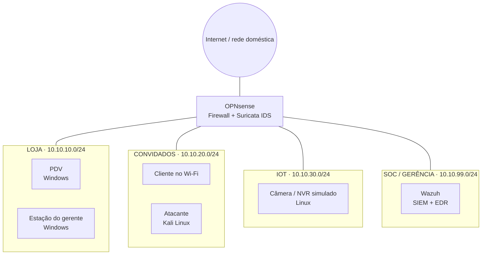

# SOC de Bolso para pequenas lojas

> Homelab de cibersegurança que simula a rede de uma loja de varejo e a protege com ferramentas
> open source: firewall segmentado, IDS, SIEM, detecção de ataques e ferramentas de apoio para
> equipes sem especialistas em segurança.

## Motivo da criação do projeto

Pequenas empresas de varejo (lojas, franquias, comércio de bairro) operam redes com PDV, Wi-Fi de
clientes, câmeras e computadores administrativos, mas quase nunca têm monitoramento de segurança.
Um SIEM comercial e um time de SOC, apesar de necessários, não estão previstos no orçamento.

Este projeto mostra, de forma reproduzível e documentada, como montar uma camada
de segurança acessível para estes cenários usando apenas ferramentas gratuitas, e como validar que
ela funciona realizando um ataque simulado no próprio ambiente.

## Objetivos

- Reproduzir a rede típica de uma loja em ambiente virtual isolado
- Segmentar a rede e aplicar o princípio do menor privilégio no firewall
- Centralizar logs e alertas em um SIEM (Wazuh) com IDS de rede (Suricata)
- Simular ataques reais e documentar como cada um é detectado (mapeado no MITRE ATT&CK)
- Criar ferramentas que traduzem risco técnico para linguagem comum
- Publicar guias que outras pequenas empresas possam seguir

## Arquitetura do laboratório



O atacante fica, de propósito, na rede de convidados: é o cenário mais realista para uma loja
(alguém conectado ao Wi-Fi aberto tentando alcançar o PDV).

### Política de firewall (base)

| Origem | Destino permitido | Bloqueado |
|---|---|---|
| CONVIDADOS | Somente internet | Todas as redes internas |
| IOT | Somente o NVR/serviços necessários | Internet e demais redes internas |
| LOJA | Internet; Wazuh (1514/1515 TCP) | CONVIDADOS, IOT |
| SOC | Gerência de todas as redes | — |
| OPNsense | Envio de logs ao Wazuh (syslog 514/UDP) | — |

Regra padrão: tudo que não está explicitamente permitido é negado.

## Stack
 
| Função | Ferramenta |
|---|---|
| Host | Windows 11 |
| Virtualização | VirtualBox 7.x (segmentos como Redes Internas) |
| Estação de trabalho | Ubuntu 24.04 LTS no WSL2 (Git, documentação, Python) |
| Firewall / roteamento | OPNsense |
| IDS de rede | Suricata (integrado ao OPNsense) |
| SIEM / EDR | Wazuh (instalação all-in-one) |
| Endpoints | Windows 10/11, Ubuntu Server |
| Simulação de ataques | Kali Linux (VM na rede CONVIDADOS), Nmap, Atomic Red Team |
| Ferramentas próprias | Python |
 

## Roadmap

- [ ] **Fase 0 · Fundação**: hipervisor, repositório, padrão de documentação, plano de IPs
- [ ] **Fase 1 · Rede da loja**: OPNsense, segmentos, regras de firewall, validação da segmentação com Nmap
- [ ] **Fase 2 · Visibilidade**: Wazuh, agentes nos endpoints, Suricata, logs do firewall no SIEM
- [ ] **Fase 3 · Ataque e detecção**: cenários de ataque, regras customizadas, mapeamento MITRE ATT&CK, write-ups
- [ ] **Fase 4 · Auditor de rede**: ferramenta Python que varre a rede e gera relatório de risco em linguagem simples
- [ ] **Fase 5 · Analisador de phishing**: ferramenta que analisa e-mails suspeitos e explica o veredito
- [ ] **Fase 6 · Expansão**: escritório com Active Directory, honeypot em nuvem
- [ ] **Fase 7 · Guia público**: passo a passo para pequenas empresas aplicarem o que funcionou

## Estrutura do repositório

```
.
├── README.md
├── docs/
│   ├── 00-fundacao/        # decisões, plano de IPs, inventário de VMs
│   ├── 01-rede/            # OPNsense, regras, testes de segmentação
│   ├── 02-visibilidade/    # Wazuh, Suricata, integrações
│   ├── 03-deteccao/        # um write-up por cenário de ataque
│   └── decisoes/           # registro de decisões técnicas (ADR)
├── configs/                # exports de configuração (sem segredos)
├── detections/             # regras Wazuh/Sigma criadas no projeto
├── tools/
│   ├── auditor-rede/
│   └── analisador-phishing/
└── diario/                 # diário de bordo: o que fiz, o que quebrou, o que aprendi
```

## Aviso ético

Todo o conteúdo deste repositório foi desenvolvido e testado em ambiente de laboratório próprio e
isolado. As técnicas de ataque aqui documentadas servem exclusivamente para validar defesas.
Não aplique varreduras, testes ou ataques em redes de terceiros sem autorização formal por escrito.

## Autor

**Gabriel Schulze Lopes** · Analista em transição para cibersegurança (SOC / Blue Team)
Tecnólogo em Banco de Dados (Unicesumar) · Google Cybersecurity Certificate · Estudando CCNA
